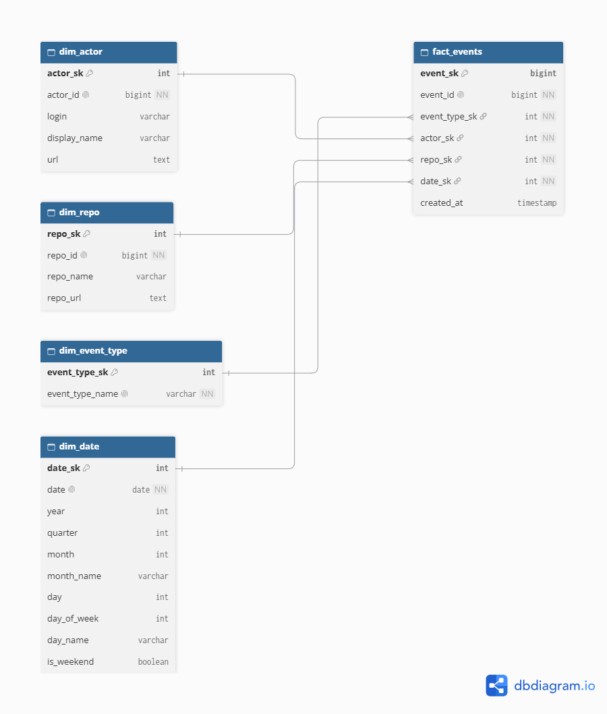

# Week 6: GitHub Archive Star Schema

## Overview

This project implements a dimensional data warehouse using PostgreSQL. It transforms GitHub Archive event data into a star schema optimized for analytical queries.

## Warehouse Architecture

The warehouse consists of five tables:

### Fact Table

- `fact_events`: Stores GitHub events and references the dimension tables through surrogate keys.

### Dimension Tables

- `dim_actor`: Stores unique GitHub actors.
- `dim_repo`: Stores unique GitHub repositories.
- `dim_event_type`: Stores GitHub event categories.
- `dim_date`: Stores calendar attributes from 2020 to 2030.

## Surrogate Keys

Surrogate keys are warehouse-generated identifiers used to uniquely identify dimension records.

They are used instead of relying directly on source system IDs because they provide consistent warehouse-managed identifiers and separate warehouse relationships from source-system identifiers.

## Unknown Dimension Records

Each non-date dimension contains an unknown record with surrogate key `-1`.

This provides a fallback for events with missing dimension information.

## Date Dimension

The date dimension contains 4,018 calendar records covering January 1, 2020, through December 31, 2030.

It includes year, quarter, month, weekday and weekend attributes.

## Entity Relationship Diagram

## Technologies

- PostgreSQL 16
- SQL
- Git
